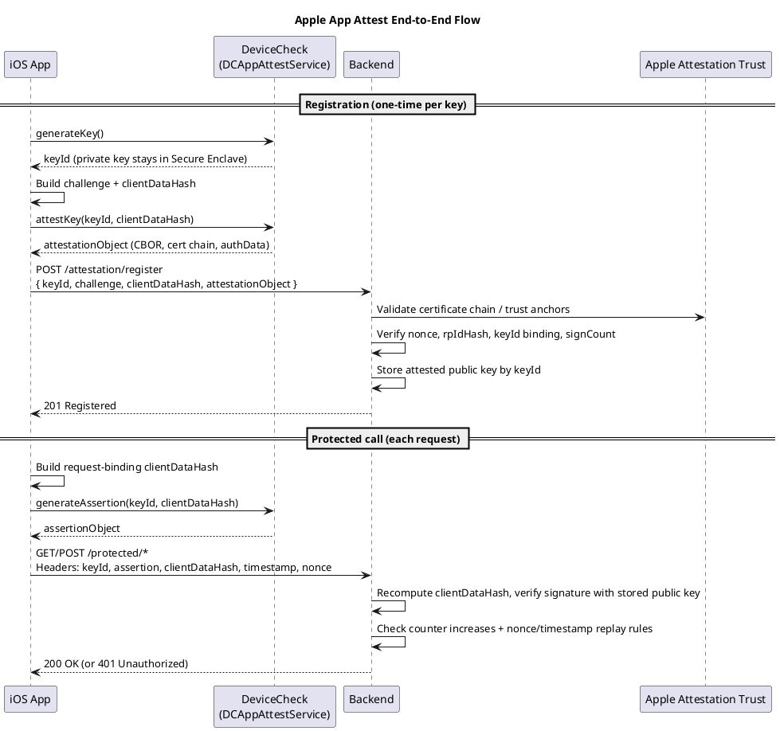

# Apple App Attest – iOS Client Guide

A learning sample that proves to a backend: *"this request came from a genuine, unmodified copy of **my** iOS app running on a real Apple device."*

This guide covers the **iOS client** in depth, then explains how to run the Spring Boot backend and how to reach it from a **real iPhone**.

---

## 1. What App Attest is

| Term | Meaning |
|---|---|
| **DeviceCheck / `DCAppAttestService`** | Apple framework that creates hardware-backed keys and signs data for your app. |
| **keyId** | An opaque ID for a key pair. The **private key never leaves the Secure Enclave**; the app only ever holds the `keyId`. |
| **Attestation** (once per key) | Apple signs a statement "this key lives in a genuine app on a genuine device". Output: `attestationObject` (CBOR with an Apple certificate chain). |
| **Assertion** (every request) | The key signs a hash of your request. Output: `assertionObject` (CBOR with `authenticatorData` + `signature`). |
| **clientDataHash** | SHA-256 you give Apple to sign. It binds the proof to *your* data (challenge or request). |

> The backend does **not** "decrypt with the public key". It **verifies** Apple's certificate chain on registration, stores the attested public key, then **verifies signatures** on each assertion.

### End-to-end flow



---

## 2. Client architecture

Clean-architecture layering with an **event-driven** SwiftUI screen: the view only emits events, the view model handles them.

```
AppAttestationLeaning/
├── AppAttestationLeaningApp.swift          // @main, creates the view model
├── BaseView.swift                          // SwiftUI screen (emits events)
├── App/AppContainer.swift                  // manual dependency injection
├── Presentation/AppAttestationViewModel.swift   // Event enum + state
├── Domain/
│   ├── Model/AttestationModels.swift       // commands / results
│   ├── Model/AppError.swift
│   ├── Ports/AttestationProvider.swift     // protocol → DeviceCheck
│   ├── Ports/AttestationRepository.swift   // protocol → network
│   └── UseCases/                           // Register, ProtectedEcho, ProtectedProfile
└── Data/
    ├── Security/ConceptAttestationProvider.swift  // DeviceCheckAttestationProvider (the real App Attest code)
    ├── API/AttestationAPIClient.swift      // URLSession + headers
    ├── API/AttestationAPIModels.swift      // DTOs
    ├── Repository/AttestationRepositoryImpl.swift
    └── Config/BaseURLProviding.swift       // backend URL
```

Dependency direction: `View → ViewModel → UseCase → (Provider, Repository) → API client`.

---

## 3. Client code walkthrough

### 3.1 The App Attest provider (the heart of the client)

`Data/Security/ConceptAttestationProvider.swift` – an `actor`, so key state is thread-safe.

```swift
actor DeviceCheckAttestationProvider: AttestationProvider {
    private let appAttestService = DCAppAttestService.shared
    private var keyId: String?
    private let bundleIdentifier = Bundle.main.bundleIdentifier ?? "unknown.bundle.id"
```

**Step 1 – create / reuse a key.** `isSupported` is `false` on the Simulator, so this fails fast there.

```swift
private func getOrCreateKeyId() async throws -> String {
    guard appAttestService.isSupported else { throw AppError.appAttestUnavailable }
    if let keyId { return keyId }
    // ...reuse stored id if present, otherwise:
    let generatedKeyId = try await generateKey()
    keyId = generatedKeyId
    return generatedKeyId
}

private func generateKey() async throws -> String {
    try await withCheckedThrowingContinuation { continuation in
        appAttestService.generateKey { keyId, error in
            if let keyId { continuation.resume(returning: keyId) }
            else { continuation.resume(throwing: error ?? AppError.keyUnavailable) }
        }
    }
}
```

DeviceCheck is callback-based, so each call is wrapped with `withCheckedThrowingContinuation` to use `async/await`.

**Step 2 – registration: attest the key.** Build a challenge, hash it, ask Apple to attest.

```swift
func createRegistrationCommand() async throws -> RegisterKeyCommand {
    let activeKeyId = try await getOrCreateKeyId()
    let timestamp = String(Int64(Date().timeIntervalSince1970 * 1_000))
    let nonce = UUID().uuidString
    let challenge = ["REGISTER", bundleIdentifier, timestamp, nonce, activeKeyId]
        .joined(separator: "\n")
    let challengeData = Data(challenge.utf8)
    let clientDataHash = SHA256.hash(data: challengeData)
    let attestationObject = try await attestKey(
        keyId: activeKeyId, clientDataHash: Data(clientDataHash))
    return RegisterKeyCommand(
        keyId: activeKeyId,
        challengeBase64Url: challengeData.base64URLEncodedString(),
        clientDataHashBase64Url: Data(clientDataHash).base64URLEncodedString(),
        attestationObjectBase64Url: attestationObject.base64URLEncodedString())
}
```

Apple embeds `SHA256(authData ‖ clientDataHash)` as a nonce inside the attestation certificate – that is how the backend ties the attestation to this challenge.

**Step 3 – every protected call: generate an assertion.** The `clientDataHash` is a hash of the *request itself* (request binding):

```swift
func createAssertion(for binding: RequestBinding) async throws -> AttestationAssertion {
    let activeKeyId = try await getOrCreateKeyId()
    let timestamp = String(Int64(Date().timeIntervalSince1970 * 1_000))
    let nonce = UUID().uuidString
    let bodyHashB64Url = Data(SHA256.hash(data: binding.bodyData)).base64URLEncodedString()
    let canonical = [
        binding.method.uppercased(),   // GET / POST
        binding.path,                  // /protected/profile
        bodyHashB64Url,                // SHA-256 of body (empty body for GET)
        timestamp,                     // epoch ms
        nonce,                         // single-use
        activeKeyId
    ].joined(separator: "\n")
    let clientDataHash = SHA256.hash(data: Data(canonical.utf8))
    let assertionObject = try await generateAssertion(
        keyId: activeKeyId, clientDataHash: Data(clientDataHash))
    // ...returns AttestationAssertion with base64url strings
}
```

Because the method, path, body, time and nonce are all inside the signed hash, a captured request **cannot be replayed or altered** (the backend rejects reused nonces, stale timestamps and non-increasing counters).

Base64URL helper (Apple returns raw bytes; headers/JSON need text):

```swift
private extension Data {
    func base64URLEncodedString() -> String {
        base64EncodedString()
            .replacingOccurrences(of: "+", with: "-")
            .replacingOccurrences(of: "/", with: "_")
            .replacingOccurrences(of: "=", with: "")
    }
}
```

### 3.2 Domain models

```swift
struct RegisterKeyCommand {
    let keyId: String
    let challengeBase64Url: String
    let clientDataHashBase64Url: String
    let attestationObjectBase64Url: String
}

struct AttestationAssertion {
    let keyId: String
    let assertionObjectBase64Url: String
    let clientDataHashBase64Url: String
    let timestampEpochMs: String
    let nonce: String
}

struct RequestBinding { let method: String; let path: String; let bodyData: Data }
```

### 3.3 Use cases

Registration just chains provider → repository:

```swift
func execute() async throws -> String {
    let command = try await provider.createRegistrationCommand()
    try await repository.register(command: command)
    return command.keyId
}
```

Protected profile builds the binding (`GET`, empty body) *exactly as the backend will recompute it*:

```swift
func execute() async throws -> ProtectedProfileResult {
    let binding = RequestBinding(method: "GET", path: "/protected/profile", bodyData: Data())
    let assertion = try await provider.createAssertion(for: binding)
    return try await repository.fetchProtectedProfile(assertion: assertion)
}
```

> **Rule:** the `method` and `path` used when signing must match the real HTTP request byte-for-byte, or the backend returns `Request binding check failed`.

### 3.4 Networking – the wire contract

`Data/API/AttestationAPIClient.swift`

**Register** – JSON body:

```swift
struct RegisterKeyRequestDTO: Encodable {
    let keyId: String
    let challenge: String
    let clientDataHash: String
    let attestationObject: String
}
// POST /attestation/register   Content-Type: application/json
```

**Protected call** – assertion travels in **headers**:

```swift
urlRequest.httpMethod = "GET"
urlRequest.setValue(assertion.keyId, forHTTPHeaderField: "X-AppAttest-Key-Id")
urlRequest.setValue(assertion.assertionObjectBase64Url, forHTTPHeaderField: "X-AppAttest-Assertion")
urlRequest.setValue(assertion.clientDataHashBase64Url, forHTTPHeaderField: "X-AppAttest-Client-Data-Hash")
urlRequest.setValue(assertion.timestampEpochMs, forHTTPHeaderField: "X-AppAttest-Timestamp")
urlRequest.setValue(assertion.nonce, forHTTPHeaderField: "X-AppAttest-Nonce")
```

| Endpoint | Method | Auth |
|---|---|---|
| `/attestation/register` | POST | JSON body with attestation |
| `/protected/echo` | POST | 5 `X-AppAttest-*` headers + JSON body |
| `/protected/profile` | GET | 5 `X-AppAttest-*` headers, no body |

Real backend errors are surfaced (not swallowed) by passing the response body into the error parser:

```swift
let (data, response) = try await session.data(for: urlRequest)
try throwIfNotSuccess(response: response, responseData: data)   // reads {"error": "..."}
```

### 3.5 Event-driven SwiftUI

The view never calls logic directly; it sends an `Event`.

```swift
// Presentation/AppAttestationViewModel.swift
enum Event {
    case registerTapped
    case protectedEchoTapped
    case protectedProfileTapped
}

func send(_ event: Event) {
    switch event {
    case .registerTapped:         Task { await handleRegister() }
    case .protectedEchoTapped:    Task { await handleProtectedEcho() }
    case .protectedProfileTapped: Task { await handleProtectedProfile() }
    }
}
```

```swift
// BaseView.swift
Button("Register Attestation")   { viewModel.send(.registerTapped) }
Button("Send Protected Echo")    { viewModel.send(.protectedEchoTapped) }
Button("Get Protected Profile")  { viewModel.send(.protectedProfileTapped) }

Section("Request")  { Text(viewModel.lastRequest)  }
Section("Response") { Text(viewModel.lastResponse) }
```

The screen shows the **real** request and the **real** backend response (no hard-coded text).

### 3.6 Dependency wiring

```swift
// App/AppContainer.swift
let provider = DeviceCheckAttestationProvider()
let registerUseCase = RegisterAttestationUseCase(repository: repository, provider: provider)
let protectedEchoUseCase = ProtectedEchoUseCase(repository: repository, provider: provider)
let protectedProfileUseCase = ProtectedProfileUseCase(repository: repository, provider: provider)
```

### 3.7 Backend URL

```swift
// Data/Config/BaseURLProviding.swift
init(baseURL: String = "http://192.168.1.3:8080/") { ... }   // change to your Mac's IP
```

---

## 4. Key handling (important learning notes)

* The **private key is always inside the Secure Enclave** – the app can never read or export it.
* The app only holds the `keyId` string. In this sample it is kept in the provider's memory (`private var keyId`); the provider also saves it in `UserDefaults` so it survives relaunch.
* **A key can be attested only once.** If the backend forgets the key (its store is in-memory, so a backend restart wipes it) but the app still remembers the old `keyId`, registration fails. Fix: delete the app from the iPhone (clears `UserDefaults`) and register again – a new key is generated.
* If you prefer pure in-memory behaviour, remove the `UserDefaults` read/write in `getOrCreateKeyId()`; every app launch then creates a fresh key (re-register after each launch).
* Assertions use a monotonically increasing **counter** maintained by Apple; the backend rejects a counter that does not increase.

---

## 5. Run the Spring Boot backend

> Note: when this guide was written the `backend-learning/attestation` folder was empty on disk. Restore the project there (or point to wherever you keep it) before running.

**Prerequisites:** JDK 25 (the `pom.xml` sets `java.version` 25) and Maven 3.9+.

```bash
java -version      # must be 25
mvn -v
```

If `java -version` fails but Maven works, set `JAVA_HOME`:

```bash
export JAVA_HOME=/opt/homebrew/Cellar/openjdk/25.0.2/libexec/openjdk.jdk/Contents/Home
export PATH="$JAVA_HOME/bin:$PATH"
```

**Configuration** – `src/main/resources/application.properties`. The backend derives the expected app identity from your Apple Team ID and bundle ID (`rpIdHash = SHA256(teamId.bundleId)`), so these must match the iOS app exactly:

```properties
app.attestation.team-id=9VL795556B
app.attestation.bundle-id=ashi.com.newLearning.ai-concept-learning.AppAttestationLeaning
app.attestation.allowed-clock-skew-ms=120000
app.attestation.nonce-retention-ms=600000
```

**Run:**

```bash
cd ~/Desktop/backend-learning/attestation
mvn spring-boot:run
```

**Verify:**

```bash
curl -i http://localhost:8080/health
# 200 {"status":"ok","time":"..."}

curl -i http://localhost:8080/protected/profile
# 401 {"error":"Missing required attestation headers"}
```

Spring Boot listens on all interfaces (`0.0.0.0:8080`) by default, which is what the iPhone needs.

---

## 6. Run the iOS app against localhost on a **real iPhone**

App Attest **does not work on the Simulator** (`isSupported == false`). Use a physical device.

### 6.1 One-time Xcode setup
1. Open `AppAttestationLeaning.xcodeproj`.
2. Target → **Signing & Capabilities** → choose your **Team** (`9VL795556B`) and keep *Automatically manage signing* on.
3. Bundle ID must equal the one in the backend property above.
4. (Optional for dev, required for TestFlight/App Store) **+ Capability → App Attest**. Without the entitlement, development builds use the *development* environment.
5. Connect the iPhone by cable, trust the computer, enable **Developer Mode** (Settings → Privacy & Security → Developer Mode), then pick the iPhone as the run destination.

### 6.2 Make the backend reachable
"localhost" on the phone means the phone itself, so use your **Mac's LAN IP**.

1. Put the **Mac and iPhone on the same Wi‑Fi** network (no guest/isolated network).
2. Find the Mac IP:
   ```bash
   ipconfig getifaddr en0        # e.g. 192.168.1.3
   ```
3. Start the backend (section 5).
4. **Check from the iPhone first:** open Safari on the phone and visit `http://192.168.1.3:8080/health`. You should see `{"status":"ok",...}`. If not, fix networking before debugging the app.
5. Set the same IP in `BaseURLStore`:
   ```swift
   init(baseURL: String = "http://192.168.1.3:8080/")
   ```
6. If macOS Firewall prompts for Java, click **Allow** (or System Settings → Network → Firewall).

### 6.3 Plain-HTTP and local-network permissions
* The target already sets `INFOPLIST_KEY_NSAppTransportSecurity_NSAllowsArbitraryLoads = YES`, which allows `http://` for this learning sample. (Use HTTPS in production.)
* On first launch iOS shows a **"Local Network"** permission prompt – tap **Allow**. If you denied it, enable it in Settings → AppAttestationLeaning → Local Network.

### 6.4 Try it
1. Run the app from Xcode on the iPhone.
2. Tap **Register Attestation** → Response shows `"result": "registered"` and the `keyId`.
3. Tap **Get Protected Profile** or **Send Protected Echo** → Response shows `"status": "accepted"`.
4. Tap again – each call uses a fresh nonce/assertion, so it keeps working. Re-sending an *old* captured request returns 401 (replay protection).

---

## 7. Troubleshooting

| Symptom (in Response box) | Cause | Fix |
|---|---|---|
| `App Attest is unavailable on this device` | Running on Simulator / unsupported device | Use a real iPhone |
| Request times out / "could not connect" | Wrong IP, different Wi‑Fi, firewall, Local Network denied | Re-check section 6.2 and 6.3; test the `/health` URL in Safari |
| `Invalid App Attest payload: ...trust anchors` | Backend not trusting Apple's App Attestation Root CA | Backend must pin Apple's App Attestation Root CA |
| `Unable to parse nonce extension` / `Expected byte[] value but found null` | Backend ASN.1 / COSE parsing | Backend parsing fixes (see backend project) |
| `keyId does not match attested public key` | keyId encoding mismatch | Backend must compare keyId as base64 / base64url of SHA-256(public key) |
| `Attestation rpIdHash does not match app identifier` | Team ID / bundle ID in properties differ from the app | Make both exactly match |
| Register fails after backend restart | Backend lost the key; app reuses an already-attested `keyId` | Delete the app and register again |
| `401 Unknown keyId` | Tapped a protected call before registering (or backend restarted) | Register first |
| `401 Request binding check failed` | Signed method/path/body differs from the real request | Keep `RequestBinding` identical to the HTTP request |
| `401 Nonce replay detected` / `Request freshness check failed` | Reused nonce or phone/Mac clocks > 2 min apart | Use a new request; sync clocks |
| `401 ...counter` | Counter did not increase | Re-register with a fresh key |

---

## 8. Learning sample vs. production

* Store keys/counters in a database, not memory.
* Use HTTPS with certificate pinning; remove `NSAllowsArbitraryLoads`.
* Issue **server-generated, single-use challenges** for registration (the sample builds the challenge on the client for simplicity).
* Add the **App Attest** entitlement and set the environment to `production` for App Store builds; backend should accept the matching environment.
* Handle `DCError.invalidKey` / re-attestation, key rotation and rate limiting.
