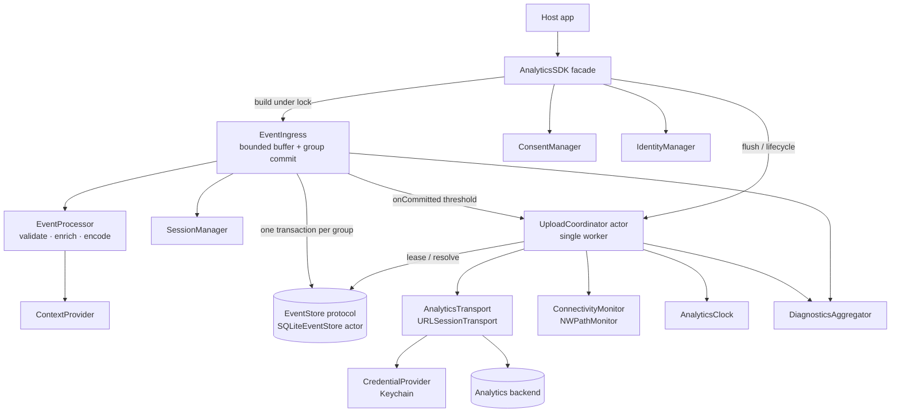
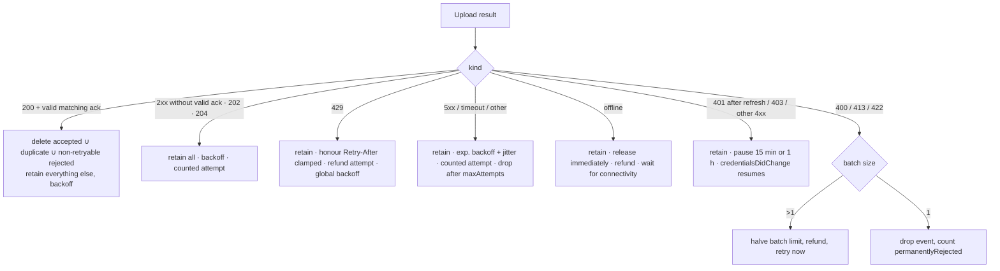

# Analytics SDK for iOS — Design (Deliverables A, B, G)

Target: iOS 17+, Swift 5 language mode, no third-party dependencies (system SQLite3, URLSession, Network.framework).
Scope: the client SDK. The backend is specified in [BACKEND_CONTRACT.md](BACKEND_CONTRACT.md), not implemented.
Cross-question answers: [DEFENSE.md](DEFENSE.md).

**Guarantee, stated once:** once `track()` returns `.persisted`, the event survives process termination. The SDK then makes
*at-least-once delivery attempts* with a *stable `event_id`*; the server de-duplicates. It does **not** guarantee exactly-once
network delivery, background execution, or delivery of events the user has revoked consent for.

---

## A1. Requirements

**Functional (all implemented unless noted in §G):** initialization/config; screen, feature and custom events with flat typed
properties; `identify`/`reset`; sessions with inactivity timeout and crash recovery; permitted context (app, OS, device model,
locale, time zone, network type, SDK version); persist-before-upload; batched upload; offline + retry; configurable batch
count/bytes/interval/network policy; public `flush()`; consent + deletion; recovery after kill/reboot; malformed events,
storage limits, server errors, partial acks; diagnostics without payload data.

**Non-functional, and where each is enforced**

| Requirement | Mechanism |
|---|---|
| No sync network / main-thread work | All public `async` methods are nonisolated; `enqueue` only takes a short lock. Network via `URLSession.upload(for:from:)` |
| Durable once committed | SQLite WAL transaction; `track` resumes *after* COMMIT (`EventIngress.commit`) |
| Bounded memory / disk / batch | `ingressCapacity`, `maxQueuedEvents`, `maxQueuedBytes`, retention, `maxBatchEvents`, `maxBatchBytes`, `maxEventBytes` |
| Thread safety | Locks for sync state, `actor` for DB and coordinator, DB leases for event ownership |
| Battery | No polling; connectivity-driven; backoff; one in-flight request; no wake-ups when idle (timer only runs while process lives) |
| Suspension/termination correctness | Persist first; leases recovered on next launch; no reliance on `applicationWillTerminate` |
| DI / testability | `AnalyticsClock`, `ConnectivityMonitor`, `EventStore`, `AnalyticsTransport`, `ContextProvider`, ID + jitter sources |
| Privacy | Consent gate in the ingress lock, PII guard rails, no ad IDs, Keychain token option, payload-free diagnostics |
| Extensibility | `schema_version` in every event; migrator; transport/store protocols |

**Assumptions** (label: *assumed*): one process owns one database file (no app-extension sharing); wall-clock timestamps are
acceptable with server-side skew correction via `sent_at`; the backend implements BACKEND_CONTRACT.md; events are ≤16 KiB;
analytics is best-effort and a bounded loss under extreme pressure (reported, never silent) is acceptable.

**Open questions for the product/backend owners:** retention period for unsent events (default 7 d); whether permanently
rejected events need a quarantine for debugging (currently dropped + counted); whether consent revocation must also trigger a
server-side deletion request (out of SDK scope); whether app extensions need to share the queue (would need a multi-process lease design).

---

## A2. Architecture



### Main event flow

```mermaid
sequenceDiagram
  participant C as Caller
  participant S as AnalyticsSDK
  participant I as EventIngress (lock)
  participant D as Drain task
  participant DB as SQLite
  participant U as UploadCoordinator
  participant N as Server
  C->>S: await track("x", props)
  S->>I: submit(build)
  Note over I: consent check · validate · session touch ·<br/>identity snapshot · timestamp · encode (all sync, ~µs)
  I-->>D: append item (single drain task, group ≤200)
  D->>DB: BEGIN; INSERT events…; UPSERT session/identity; COMMIT
  D-->>C: resume (durable)
  D->>U: noteEnqueued(n) → threshold?
  U->>DB: lease batch (txn): select eligible, set lease_id, attempts+1
  U->>N: POST batch (actor released during await)
  N-->>U: 200 {accepted, duplicate, rejected}
  U->>DB: resolve (txn): delete confirmed + non-retryable, release rest with retryAt
```

### Failure and acknowledgment flow



**The lost-acknowledgment scenario** (server stored the batch; response lost or app killed before local delete):
the events stay in SQLite under the same `event_id` and byte-identical payload; on the next pass they are re-sent;
the server answers them in `duplicate_event_ids`; the SDK treats duplicates as confirmed and deletes them in one transaction.
Covered by `testLostAcknowledgmentThenRetryReusesIDsAndDuplicateAckClearsQueue` and `testKillDuringUploadRecoversAbandonedLeaseOnNextLaunch`.

---

## A3. Trade-offs and chosen defaults

| Decision | Chosen | Alternative | Why / when to switch |
|---|---|---|---|
| Concurrency primitive | `actor` for DB + coordinator; `NSLock` for tiny sync state | Serial `DispatchQueue` | Actors compose with `async/await`, give compiler-checked isolation, no queue-hopping callbacks. Queues are fine pre-iOS 13 or when you must expose sync APIs. **Actors do not make multi-step workflows atomic** (re-entrancy at every `await`): atomicity comes from SQLite transactions with no `await` inside, and from DB leases. |
| Storage | SQLite (system library) | Core Data; SwiftData | Need transactions, partial indexes, `INSERT OR IGNORE`, bounded `LIMIT` scans, WAL, and a schema you control byte-for-byte. Core Data's object graph is overhead for a queue; SwiftData needs iOS 17 and has less control over locking/WAL. No third party: a ~150-line wrapper behind `EventStore`; swap to GRDB if the team already uses it. |
| Architecture | Thin facade over injected components | Singleton-heavy | Facade keeps public surface small and stable; components are constructor-injected, so tests and multiple projects (one SDK instance per project) work. A convenience `shared` is the host's choice. No global mutable state. |
| Workers | One upload worker | N workers | Ordering, simplicity, one radio wake-up. Leases make N workers *correct*, but throughput is bounded by `batch/RTT`. Raise only when metrics show queue age growing under healthy network (see DEFENSE Q25). |
| Triggers | Threshold + lifecycle + connectivity + backoff wake + best-effort interval + explicit flush | Timer only | Timers do not fire while suspended and waste wake-ups; event-driven triggers fire exactly when something changed. The interval is only a safety net. |
| Buffering | Bounded in-memory buffer **only** as a group-commit stage; DB is the source of truth | Memory-only batching | Memory batches are lost on kill. Group commit (≤200 rows/txn) keeps single-event latency low *and* throughput high. Weaker mode: `enqueue` is "accepted", not durable (documented). |
| Transport | Foreground async `URLSession` | Background `URLSession` | Batches are ≤256 KiB and the queue is already durable. Background sessions need file-backed bodies, delegate reattachment on relaunch, and make ack handling asynchronous. Use them for large/rare uploads or when uploads must survive suspension. |
| Wire format | JSON (sorted keys, ISO-8601 ms) | Protobuf / MessagePack / gzip | Debuggable, trivially spliced byte-exact into batches (exact byte limits, byte-identical retries). Compression is a straightforward next step (needs real gzip, not `NSData.compressed`). |

**Why a byte limit as well as a count limit:** 50 events of 100 B is 5 KB; 50 events of 16 KB is 800 KB. A count limit alone
bounds neither request size (servers/proxies reject large bodies with 413), nor memory, nor radio-on time on cellular.
Payloads are stored as their exact wire JSON, so `LeaseRequest.maxBytes` is enforced exactly (asserted in `testBatchesRespectCountAndByteLimits`).

---

## A4. Public API contract

| Question | Decision |
|---|---|
| `track` sync or async? | `async throws`; plus non-blocking `enqueue` for hot paths. |
| When does `track` return? | After the SQLite COMMIT that contains the event. |
| Invalid events? | `track` throws `AnalyticsError.validation(...)`; `enqueue` returns `.rejected(...)`. Nothing is stored. Errors contain keys/codes, never values. |
| Backpressure? | Ingress buffer full → `.backpressure` thrown/returned and counted. Never unbounded growth. |
| Persistence failure? | Thrown (`storageFull`, `diskFull`, `storageCorrupted`, `storageFailure`). Event is **not** recorded and will never be sent. For `enqueue`: `onError` + metrics. |
| `initialize()` twice? | Idempotent; concurrent calls share one task; failure resets so it can be retried; caller cancellation does not cancel the shared init. |
| `flush()` | Waits for a pass that *starts after* the call; concurrent calls share passes. Returns `FlushReport` (status: completed/offline/backingOff/auth/consentDenied/…). `requestFlush()` only asks. |
| Identity change vs queued events | Never rewritten. `identify` keeps `anonymous_id` (server aliases history); switching users ends the session and rotates `anonymous_id`; `reset()` = logout. |
| Consent revocation vs persisted events | Default `.deleteQueuedEvents`: flip flag inside the ingress lock → discard buffer → persist "denied" → wait for in-flight commit → delete all rows → reset identity/session. A crash between steps is finished at next `initialize()`. `.retainQueuedEvents` keeps rows but never uploads them. |
| Default consent | `.denied` (opt-in). Hosts set `initialConsent` or call `setConsent`. |

---

## A5. Persistence (SQLite)

```sql
events(seq PK AUTOINCREMENT, event_id TEXT UNIQUE, created_at REAL, payload BLOB, payload_bytes INT,
       attempts INT, next_attempt_at REAL, lease_id TEXT, lease_expires_at REAL)
INDEX idx_events_eligible (lease_id, next_attempt_at, seq)      -- lease scan
INDEX idx_events_lease    (lease_id) WHERE lease_id IS NOT NULL -- resolve by batch
INDEX idx_events_created  (created_at)                          -- retention
metadata(key PK, value)                                         -- consent, identity, session
```

* **Transactions:** `BEGIN IMMEDIATE … COMMIT`; any throw (including a failing COMMIT such as `SQLITE_FULL`) rolls back.
  No `await` occurs inside a transaction, so actor re-entrancy cannot interleave two.
* **Atomic batch selection / leases:** `leaseBatch` selects eligible rows and stamps `lease_id`/`lease_expires_at`/`attempts+1` in one transaction.
  Leased rows are invisible to other callers (tested with 16 concurrent leases: no overlap).
* **Abandoned leases:** expired leases are released each pass; *all* leases are released at startup. The attempt is **not** refunded, so a payload that crashes the process cannot loop forever.
* **Identity/session state** commits in the *same* transaction as the events that reference it.
* **Bounds:** `maxQueuedEvents` and `maxQueuedBytes` (payload bytes) enforced inside the insert transaction; `.dropOldest` evicts oldest *unleased* rows (never in-flight ones), `.rejectNew` throws. Retention purge each pass. `auto_vacuum=INCREMENTAL` + `incremental_vacuum` after bulk deletes; `journal_size_limit`.
* **Migrations:** `PRAGMA user_version`; each migration in its own transaction; a newer DB (app downgrade) is refused with `incompatibleDatabase`.
* **Corruption:** `SQLITE_CORRUPT/NOTADB` at open or runtime → file moved to `events.sqlite.corrupt-<ts>`, fresh DB created, metric `databaseRebuilt`, and the in-flight call throws `storageCorrupted`. Queued events in a corrupt file are lost; this is reported, not hidden.
* **Durability level:** WAL + `synchronous=NORMAL` survives process death; the last few commits can be lost on OS crash/power loss. `SQLiteEventStore.Durability.full` closes that at a latency cost.
* File excluded from backup; `completeUntilFirstUserAuthentication` protection on iOS so background uploads work when locked.

## A6. Concurrency model

* `track`/`enqueue`: build step runs under one lock (consent, validation, session, identity, timestamp, encode). This gives a single total order consistent with timestamps and makes consent/identity flips atomic with respect to event creation. Cost: ~microseconds of serialized work.
* One drain task commits groups of ≤200 events. Tasks created = at most one drain task + one task per commit notification, **not** one per event.
* `UploadCoordinator` is an actor that is *released* during every `await` (store and network). Triggers only bump `requestedGeneration`; the single worker loops until `completedGeneration` catches up, so N simultaneous triggers collapse into one extra pass. `flush()` waiters are tied to generations.
* Cancellation: the worker is owned by the coordinator, not by any caller, so cancelling a `flush()` caller cannot abort an upload or corrupt a lease. `shutdown()` cancels the worker; the cancelled request returns `.network(.cancelled)`, which releases the lease and refunds the attempt.
* Config updates: `UploadSettings` snapshot is read at the start of each batch; updates are validated and swapped atomically.
* Ordering: events are stored in `seq` (ingestion) order and leased oldest-first. Retries after backoff can reorder delivery; consumers must order by `timestamp`/`event_id`, not arrival.

## A7. iOS lifecycle

Active → request a pass (and roll the session if expired). Background → `beginBackgroundTask` (UIKit runner, best effort) around `flush()`; if the OS denies or revokes the time nothing is lost. Suspension → nothing runs; the interval timer simply doesn't fire. Termination/kill/reboot → no callback is relied on; at next `initialize()` all leases are released and a pass starts. Connectivity change → pass. Session recovery is described in `SessionManager`. Background `URLSession` is deliberately not used (see A3).

## A8. Metrics and investigation

Emitted via `AnalyticsMetricsSink` and `diagnostics()`: track latency; events persisted; drops by reason (`backpressure`, `storageFull`, `evictedForSpace`, `retentionExpired`, `maxAttempts`, `permanentlyRejected`, `consentRevoked`, `persistenceFailed`); upload outcome, size, bytes, duration; creation→ack latency (avg/max); retries scheduled; queue size/bytes/oldest age; DB rebuilds; pause/backoff deadlines.
*Unhealthy:* `oldestEventAge` rising · `uploadSuccessRate` falling · `retriesScheduled`/`eventsAcknowledged` ratio high · any `maxAttempts`/`permanentlyRejected` growth · `databaseRebuilds > 0` · `pendingEvents` near `maxQueuedEvents`.
*Memory growth:* ingress is capped by `ingressCapacity × maxEventBytes`; check `backpressure` drops and Instruments allocations for `EventIngress.Item`. *DB growth:* `databaseDiskBytes` vs `queuePayloadBytes` (large gap → vacuum/WAL), check `oldestEventAge` vs retention. *Repeated retries:* look at `lastUploadOutcome` and attempts distribution. *Slow uploads:* `averageUploadDuration` vs `averageBatchSize`, reduce `maxBatchBytes`. Logs use `os.Logger` with reason codes and counts only.

---

## B. Project structure

```
AnalyticsSDK/
├── Package.swift
├── scripts/run-tests.sh            swiftc + Swift Testing runner (TestRunner.swift) for sandboxed environments; normal path: `swift test`
├── docs/                           DESIGN.md · BACKEND_CONTRACT.md · DEFENSE.md
├── Sources/AnalyticsSDK/
│   ├── Public/        AnalyticsSDK · AnalyticsConfiguration · AnalyticsEvent · AnalyticsValue · AnalyticsError · SDKRuntime · BackgroundTaskRunner
│   ├── Processing/    EventProcessor · ContextProvider · IdentityManager · EventIngress
│   ├── Sessions/      SessionManager
│   ├── Storage/       EventStore (protocol+types) · SQLiteDatabase · SQLiteEventStore · DatabaseMigrator
│   ├── Upload/        UploadCoordinator · AnalyticsTransport · UploadRequest · UploadAcknowledgment · RetryPolicy
│   ├── Privacy/       ConsentManager
│   ├── Diagnostics/   AnalyticsDiagnostics
│   └── Support/       Support (Locked, Clock, keys) · Connectivity · Credentials
└── Tests/AnalyticsSDKTests/        TestSupport · EventProcessorTests · EventStoreTests · UploadCoordinatorTests · AnalyticsSDKTests
```
Deviation from the sketch: `Support/` and `SDKRuntime`/`EventIngress`/`IdentityManager` are added because group commit, the
object graph, and identity needed homes; `ConsentManager` is kept tiny (a flag) because the consent *workflow* touches the
ingress, store and coordinator and therefore lives in the facade.

---

## G. Implemented, simplified, and still required

**Implemented and tested** (62 Swift Testing tests): validation/PII guard rails; stable IDs and byte-identical retries; context enrichment;
sessions incl. restart recovery; SQLite durability/reopen, rollback, leases (concurrent), byte/count limits, capacity policies,
retention, migrations, corruption recovery; ack resolution (partial, duplicate, contradictory, malformed, non-durable 2xx);
429/Retry-After, 5xx backoff + attempt budget, 401 pause/resume, offline, network policy, poison-batch bisection, concurrent flush,
group commit under 1,000 concurrent tracks and 10,000 rapid `enqueue`; consent default/revocation/restart; identity semantics; shutdown.

**Simplified**
* One upload worker; `maxConcurrentUploads` is fixed at 1 (not a config knob, because exposing a knob that does nothing would mislead).
* Permanently rejected events are dropped and counted, not quarantined.
* Disk limit is payload bytes, not file size (WAL/page overhead extra).
* No compression; no client-side clock-skew correction (server uses `sent_at`).
* Event ordering across retries is best effort.
* `requestFlush`/`onCommitted` spawn short tasks (coalesced / one per commit), not one per event.

**Not verified in this environment** (honest status): `swift build`/`swift test` could not run here because SwiftPM's own sandbox is blocked;
the suite was built with `scripts/run-tests.sh` (swiftc + Swift Testing entry point, macOS arm64, Swift 6.3.3, language mode 5) and passes 62/62 over three runs.
The iOS-only code (`UIKitBackgroundRunner`, `.protectionKey`) was *type-checked* against the iOS 15 simulator SDK but never executed.
Not exercised by any test: `PathMonitorConnectivity`, `KeychainCredentialProvider`, real `URLSession` I/O (only response classification is tested), real process kill (simulated by relaunching on the same file), device-level power-loss durability.

**Production requirements before shipping**
1. Run `swift test` / Xcode on an iOS simulator and device; add a `URLProtocol` stub test for `URLSessionTransport.send` (header set, 401 refresh, cancellation).
2. Backend implements the contract (atomic durable accept + dedupe by `(project_id, event_id)`).
3. Privacy review of the PII heuristics and defaults; App Privacy manifest (`PrivacyInfo.xcprivacy`) and a check of Apple's required-reason API list against what the SDK touches (it uses `FileManager`, `sysctlbyname("hw.machine")`, `ProcessInfo`; not audited here).
4. Load/soak test on low-end devices; tune `ingressCapacity`, batch sizes; verify battery with Instruments Energy Log.
5. Decide on app-extension support (needs a cross-process lease/locking story) and BGTaskScheduler integration for opportunistic uploads.
6. Real-device test of `beginBackgroundTask` expiry behaviour; fault-injection tests for `SQLITE_FULL` and I/O errors.
7. Consider gzip and a quarantine table once real server rejection rates are known.
